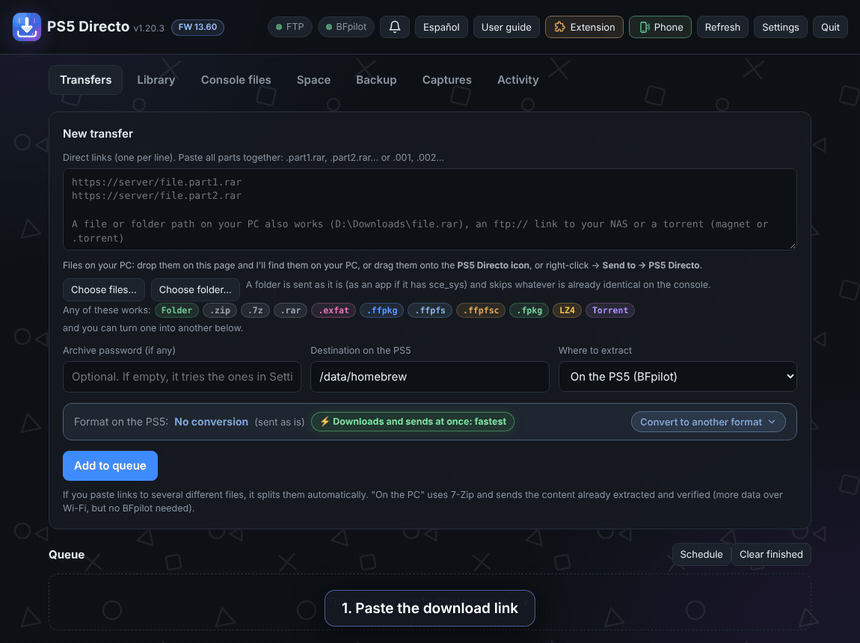
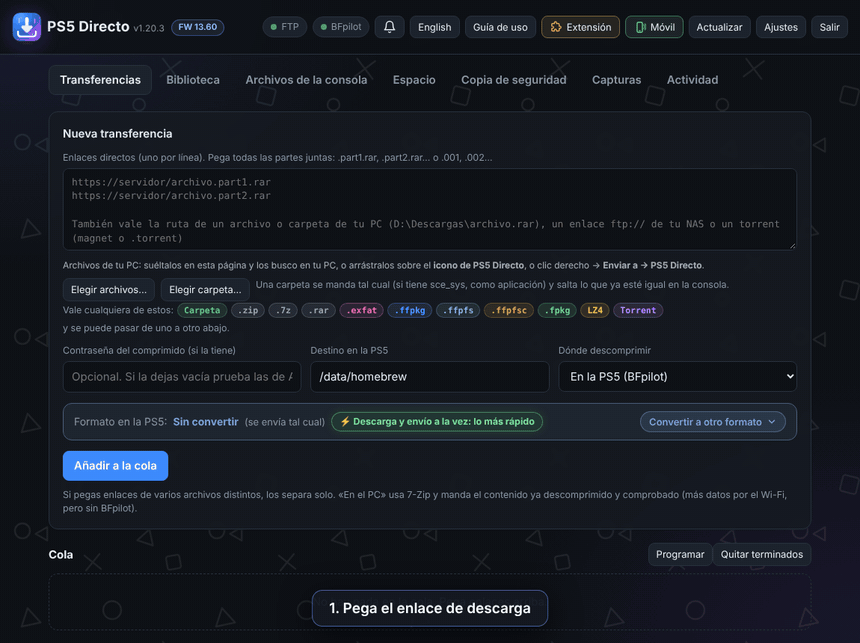

# PS5 Directo

**English** · [Español](#español)

An all-in-one Windows tool for jailbroken PS5 consoles: it **downloads, converts and sends** in a single step. Sent as is, files go to the console over FTP **while they download**, without storing them on your PC; or it **converts them on the fly** (LZ4, `.exfat`, folder, `.ffpfsc`…) as part of the same job, no second program needed. It extracts on the console (BFpilot) or on the PC (7-Zip), places apps in `/data/homebrew` so ShadowMountPlus shows them in the menu, and lets you browse your console's library with covers and control everything from your phone.

Demo with a sample homebrew app served from a NAS on the local network.

### ⚡ One step instead of three tools
- ✅ **Download and send at once:** files go straight to the console while they download, nothing stored on your PC
- ✅ **Or convert on the fly** with [PS5 Dump Forge](https://github.com/quer3q/ps5-dump-forge) (downloaded and updated automatically): folder, `.exfat`, LZ4, `.ffpfsc`, `.ffpkg`, `.ffpfs` or `.fpkg`, with a "Which one?" guide by need
- ✅ **Any source:** download links, `ftp://` (e.g. a NAS), torrents (magnet or `.torrent`) or files and folders on your PC (drag and drop or "Send to")
- ✅ **Extracts and places:** joins split parts, extracts RAR, 7z, ZIP and tar on the console (BFpilot) or on the PC (7-Zip, CRC-checked), splits archives with a backport and places apps in `/data/homebrew` for ShadowMountPlus
- ✅ **Reliable:** pause, resume and retry where it left off, several connections per file, `.sfv`/`.md5` checks, free-space watch and permission fixes (CE-107750-0)

### 📚 Your console from your PC and phone
- ✅ **Library:** covers, versions and required firmware for everything on the console, including images and installed PS4/PS5 content; flags what won't launch on your firmware, duplicates and broken folders, and links to each title's public update list
- ✅ **On your PC:** point it at your PC/NAS folders, see what's missing on the console and send it with one click
- ✅ **Backup:** saved data, ShadowMountPlus/payload settings and the app database copied to the PC, manually or daily; restore saved data to the same console
- ✅ **Console files, Space and Captures:** file browser (copy, move, rename, upload, download), storage chart with "Make room", and the console's screenshots and videos
- ✅ **Phone and browser:** use it from your phone with a QR code, and send links from your browser with the optional extension

### 🩺 When something goes wrong
- ✅ **Diagnosis** on failed transfers: cause, error codes and how to fix it
- ✅ **Launch check:** if an app closes on launch, it checks the folder (executable, permissions, firmware, backports, LZ4 packing) and shows recent logs and captures
- ✅ **Problem report** in one click (.zip, no passwords) to share when asking for help
- ✅ **Warnings:** your PS5 firmware always visible, speed-drop alerts, "Why is it slow?" network check, and it loads ftpsrv/BFpilot from the app
- ✅ **Self-updating**, with a welcome window and a user guide, in English and Spanish

## Requirements

- **PC:** Windows 10/11. Nothing else to install: the download includes everything it needs. Optional: [7-Zip](https://www.7-zip.org/), only if you want to extract on the PC instead of on the console.
- **Mac (new, in testing — not tested on a real Mac yet, [feedback welcome](../../issues/new?template=mac.md)):** macOS 11 or later, Apple Silicon or Intel. Python and 7-Zip are included. Torrents need `aria2` (`brew install aria2`).
- **Linux (new, x86-64):** any recent distro (glibc 2.35+, e.g. Ubuntu 22.04+). Python and 7-Zip are included. For the app window without tabs, Chrome, Chromium, Edge or Brave (otherwise it opens in your default browser). Torrents need `aria2` (`sudo apt install aria2`).
- **Jailbroken PS5:**
  - An FTP server, for example [ftpsrv](https://github.com/ps5-payload-dev/ftpsrv) on port 2121.
  - [BFpilot](https://github.com/ItsBlurf/BFpilot) on port 5905.
  - [ShadowMountPlus](https://github.com/drakmor/ShadowMountPlus).
  - Payloads can be loaded with [ps5-payload-manager](https://github.com/itsPLK/ps5-payload-manager).

## Getting started

1. Download **`PS5Directo-X.Y.Z-Setup.exe`** from the latest [release](../../releases), open it and click **Install**. No admin rights needed, nothing else to install.
2. Open **PS5 Directo** from the desktop or the Start menu. The language follows Windows; switch it with the **English / Español** button at the top.
3. Follow the welcome guide, enter your PS5's IP in Settings, then paste links or drop files.

> If Windows shows "Windows protected your PC", click **More info → Run anyway**. The installer isn't signed (signing costs money); it's the usual warning for small free programs.
>
> Rather not install? Download `PS5Directo-X.Y.Z-Windows.zip` instead, extract it anywhere and run `Crear accesos directos.bat`. Both update themselves the same way.

**Mac (in testing):** download `PS5Directo-X.Y.Z-macOS.dmg`, open it and drag **PS5 Directo** into Applications. The app isn't signed by Apple, so the first time macOS blocks it: on macOS 15+ go to *System Settings → Privacy & Security → Open Anyway*; on older versions right-click the app → *Open*. **It hasn't been tested on a real Mac yet:** if something fails, click *Create problem report* in the program and attach it to an [issue](../../issues/new?template=mac.md). Thanks!

**Linux:** download `PS5Directo-X.Y.Z-Linux.tar.gz`, extract it anywhere (for example in your home folder) and open it once with `./ps5directo.sh` in a terminal (or right-click → *Run as a Program*). That first time it adds **PS5 Directo** to your applications menu, so from then on you open it from there. It updates itself like on Windows.

> **About BFpilot and permissions:** up to at least v0.4.4, BFpilot's archive extractor leaves files without the execute bit, so the PS5 refuses to launch them (CE-107750-0). This also happens when you extract from BFpilot's own web UI. PS5 Directo fixes it automatically after every extraction. For content you already have, use **Settings → Fix permissions**.

The full guide is in [README_EN.txt](README_EN.txt) (Spanish: [LEEME.txt](LEEME.txt)).

## Publishing a release

Bump `VERSION` in `app.py`, add the notes to `LEEME.txt` / `README_EN.txt`, then push a tag (`git tag v1.20.3 && git push --tags`). The GitHub Action builds the installer `PS5Directo-X.Y.Z-Setup.exe`, `PS5Directo-X.Y.Z-Windows.zip`, `PS5Directo-X.Y.Z-Linux.tar.gz` and `PS5Directo-X.Y.Z-macOS.dmg` (all with Python included; the Mac app is built and smoke-tested on a GitHub macOS runner) and creates the release. The installer script is `installer/PS5Directo.iss` (Inno Setup).

## Disclaimer

Independent project, not affiliated with Sony or with the authors of the tools mentioned. It's a file-transfer tool: it includes no third-party content, no Sony keys or files, and no links to download sites. Use it only with content you have the right to use (your own backups and homebrew).

- It does not jailbreak the console or bypass any protection: it only copies files to a console you have already modified yourself.
- No piracy: don't use it to copy or run software you don't own or aren't licensed to use. Requests for help getting such content are not answered.
- You are responsible for how you use it. Modifying a console can void its warranty, break its terms of service or lose data: back up what matters.
- Provided "as is", without warranty of any kind. "PlayStation" and "PS5" are trademarks of Sony Interactive Entertainment, used only to describe compatibility.

---

## Español

Herramienta todo en uno para Windows y PS5 con jailbreak: **descarga, convierte y envía** en un solo paso. Tal cual, los archivos van a la consola por FTP **mientras se descargan**, sin pasar por el disco del PC; o los **convierte sobre la marcha** (LZ4, `.exfat`, carpeta, `.ffpfsc`…) dentro del mismo trabajo, sin usar otro programa. Descomprime en la consola (BFpilot) o en el PC (7-Zip), coloca las aplicaciones en `/data/homebrew` para que ShadowMountPlus las muestre en el menú, y te deja ver la biblioteca de la consola con portadas y controlarlo todo desde el móvil.

**Un programa en vez de tres:** descarga y envío a la vez sin ocupar el PC, o conversión sobre la marcha (carpeta, `.exfat`, LZ4, `.ffpfsc`, `.ffpkg`, `.ffpfs`, `.fpkg`) con [PS5 Dump Forge](https://github.com/quer3q/ps5-dump-forge). Vale con enlaces, `ftp://`, torrents o archivos del PC; une partes, descomprime y lo deja colocado.

**Tu consola desde el PC y el móvil:** Biblioteca con portadas, versión y firmware (también lo instalado de PS4 y PS5), vista «En tu PC» para enviar lo que falta, copias de seguridad de partidas y ajustes, explorador de archivos, espacio, capturas y modo móvil con QR.

**Cuando algo falla:** diagnóstico de errores con causa y solución, «Comprobar» si algo se cierra al abrirlo, informe de fallo en un clic y avisos automáticos de versiones y de bajadas de velocidad.

**Requisitos:** Windows 10/11, sin instalar nada más: la descarga lo trae todo. Opcional: [7-Zip](https://www.7-zip.org/), solo si quieres descomprimir en el PC en vez de en la consola. En la PS5: servidor FTP ([ftpsrv](https://github.com/ps5-payload-dev/ftpsrv)), [BFpilot](https://github.com/ItsBlurf/BFpilot) y [ShadowMountPlus](https://github.com/drakmor/ShadowMountPlus).

**Cómo instalarlo:**
1. Descarga **`PS5Directo-X.Y.Z-Setup.exe`** de la última [release](../../releases), ábrelo y pulsa **Instalar**. No pide permisos de administrador ni hay que instalar nada más.
2. Abre **PS5 Directo** desde el escritorio o el menú Inicio.
3. Sigue la ventana de bienvenida y pon la IP de tu PS5 en Ajustes.

Si Windows dice «Windows protegió su PC», pulsa **Más información → Ejecutar de todos modos** (el instalador no está firmado, que cuesta dinero; es el aviso normal en programas pequeños y gratuitos). ¿Prefieres no instalar? Descarga el `.zip`, descomprímelo y ejecuta `Crear accesos directos.bat`. La guía completa está en [LEEME.txt](LEEME.txt).

**Mac (nuevo, en pruebas):** descarga `PS5Directo-X.Y.Z-macOS.dmg`, ábrelo y arrastra **PS5 Directo** a Aplicaciones. No está firmada por Apple, así que la primera vez macOS la bloquea: en macOS 15 o posterior ve a *Ajustes del Sistema → Privacidad y seguridad → Abrir igualmente*; en versiones anteriores, clic derecho en la app → *Abrir*. **Todavía no se ha podido probar en un Mac de verdad:** si algo falla, pulsa *Crear informe de fallo* en el programa y adjúntalo en un [aviso](../../issues/new?template=mac.md). ¡Gracias!

**Linux (nuevo):** descarga `PS5Directo-X.Y.Z-Linux.tar.gz`, descomprímelo donde quieras y ábrelo una vez con `./ps5directo.sh` en una terminal (o clic derecho → *Ejecutar como programa*). Esa primera vez se añade solo al menú de aplicaciones, y desde entonces lo abres desde ahí. Trae Python y 7-Zip; para los torrents hace falta `aria2` (`sudo apt install aria2`).

**Aviso:** proyecto independiente, sin relación con Sony ni con los autores de las herramientas citadas. No incluye contenido de terceros, claves ni archivos de Sony, ni enlaces a sitios de descargas. Úsalo solo con contenido que tengas derecho a usar (copias de seguridad propias y homebrew). No hace el jailbreak ni salta ninguna protección: solo copia archivos a una consola que ya has modificado tú. No se da ayuda para conseguir contenido sin licencia. Se ofrece tal cual, sin garantías, y lo que hagas con él es responsabilidad tuya.
