# PS5 Directo

**English** · [Español](#español)

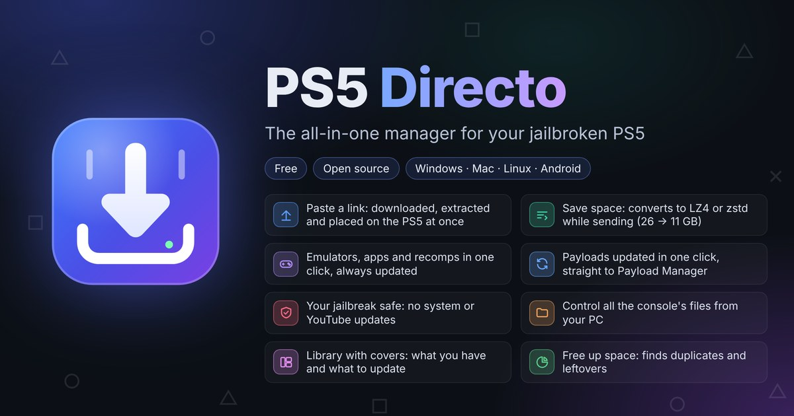

**The all-in-one manager for your jailbroken PS5**, free and open source, for Windows, Mac and Linux (plus a phone app). It's not just an uploader that sends files you already have: you paste a link and PS5 Directo downloads it, sends it to the console *at the same time*, extracts it, makes it smaller if you want, and leaves it ready in the PS5 menu.

**[⬇ Download the latest version](../../releases/latest)**

## Why it's different

| | |
|---|---|
| 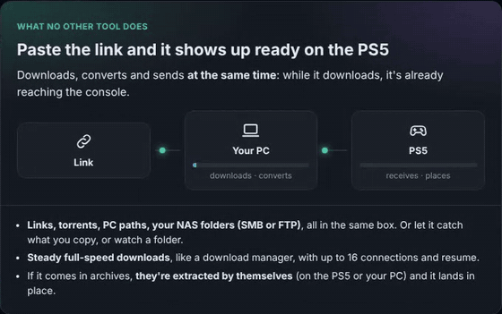 | 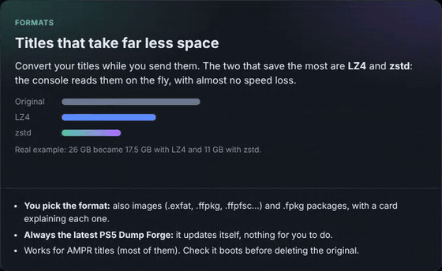 |
| **Paste a link, done.** Download links, torrents, PC folders or your NAS. It downloads and sends at the same time, extracts on the console or the PC, fixes permissions and leaves it ready for ShadowMountPlus. | **Titles that take far less space.** It converts to LZ4 or zstd on the way (26 GB → 11 GB in our test). The console reads them on the fly. Images (`.exfat`, `.ffpkg`, `.ffpfsc`…) and `.fpkg` too. |
| 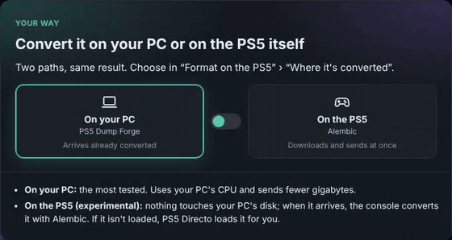 | 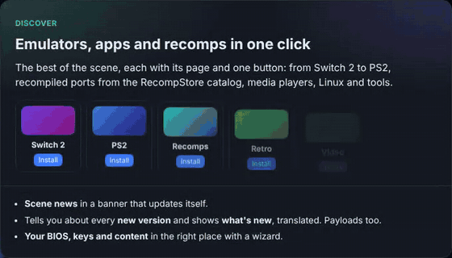 |
| **Converted wherever you want.** On your PC with the latest [PS5 Dump Forge](https://github.com/quer3q/ps5-dump-forge) (it arrives already smaller), or on the PS5 itself with [Alembic](https://github.com/fthdgn-gh/Alembic) (downloads and sends at once, the console converts it at the end). | **Emulators, apps and recomps in one click.** Switch 2, PS2, GameCube, Xbox 360, retro, media players, Linux and the whole RecompStore catalog. It tells you about every new version, with its notes translated. |
| 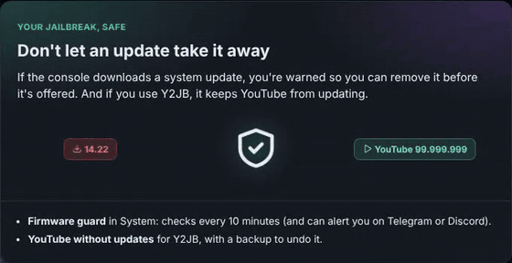 | 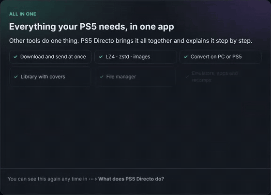 |
| **Your jailbreak, safe.** If the console downloads a system update, it warns you so you can remove it before it installs. It can also stop YouTube from updating for Y2JB. | **Everything else in one app.** Library with covers, file manager, space cleanup, payloads kept up to date, backups and captures, Remote Play, Linux on the PS5, and control from your phone or browser. |

## Download and install

| System | File | How |
|---|---|---|
| **Windows 10/11** | `PS5Directo-X.Y.Z-Setup.exe` | Open it and click **Install**. No admin rights, nothing else to install. |
| **Mac** (beta) | `PS5Directo-X.Y.Z-macOS.dmg` | Drag **PS5 Directo** into Applications. See the note below. |
| **Linux** (x86-64) | `PS5Directo-X.Y.Z-Linux.tar.gz` | Extract it and open `./ps5directo.sh` once; it adds itself to the apps menu. |
| **Android** | `PS5Directo-X.Y.Z-Android.apk` | Two ways: with your PC (scan the QR in **Phone**) or **without a PC** (beta): the phone does it all by itself. |

All of them are in the [latest release](../../releases/latest). PS5 Directo updates itself from inside the app.

- **Windows:** if it says "Windows protected your PC", click **More info → Run anyway** (the installer isn't signed, which costs money). Rather not install? Use `PS5Directo-X.Y.Z-Windows.zip` and run `Crear accesos directos.bat` (create shortcuts).
- **Mac:** the app isn't signed by Apple. The first time, go to *System Settings → Privacy & Security → Open Anyway* (on older macOS: right-click the app → *Open*). If macOS says it **"is damaged"**, run this once in Terminal: `xattr -dr com.apple.quarantine "/Applications/PS5 Directo.app"`.
- **Linux:** torrents need `aria2` (`sudo apt install aria2`). For the app window, Chrome, Chromium, Edge or Brave; otherwise it opens in your browser.

## What you need on the PS5

A jailbroken PS5 on the same network as your PC, with:

- an FTP server, for example [ftpsrv](https://github.com/ps5-payload-dev/ftpsrv) (port 2121);
- [BFpilot](https://github.com/ItsBlurf/BFpilot) (port 5905), to extract on the console;
- [ShadowMountPlus](https://github.com/drakmor/ShadowMountPlus), so what you send shows up in the menu.

PS5 Directo checks them, tells you what's missing and can load them for you with [Payload Manager](https://github.com/itsPLK/ps5-payload-manager).

## Getting started

1. Open PS5 Directo. The language follows your system; switch it with **English / Español** at the top.
2. Follow the welcome window: enter your PS5's IP and it checks the connection and your firmware.
3. Paste a link or drop a file, choose the format if you want, and **Add to queue**.

The first time you'll see a short tour of everything it does. You can watch it again from **⋯ › What does PS5 Directo do?**. The full guide is in [README_EN.txt](README_EN.txt).

## Disclaimer

Independent project, not affiliated with Sony or with the authors of the tools it uses. It's a file manager: it includes no third-party content, no Sony keys or files, and no links to download sites. Use it only with content you have the right to use (your own backups and homebrew).

- It does not jailbreak the console or bypass any protection: it only works with a console you have already modified yourself.
- Requests for help getting unlicensed content are not answered.
- You are responsible for how you use it. Modifying a console can void its warranty, break its terms of service or lose data: back up what matters.
- Provided "as is", without warranty of any kind. "PlayStation" and "PS5" are trademarks of Sony Interactive Entertainment, used only to describe compatibility.

---

## Español

**El gestor todo en uno de tu PS5 con jailbreak**, gratuito y de código abierto, para Windows, Mac y Linux (con app para el móvil). No es solo un programa para subir archivos que ya tienes: pegas un enlace y PS5 Directo lo descarga, lo manda a la consola *a la vez*, lo descomprime, lo hace ocupar menos si quieres y lo deja listo en el menú de la PS5.

**[⬇ Descargar la última versión](../../releases/latest)**

## Lo que lo hace distinto

| | |
|---|---|
| 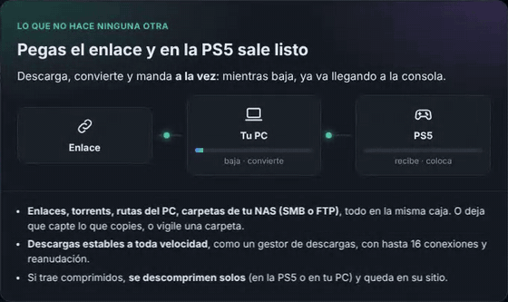 | 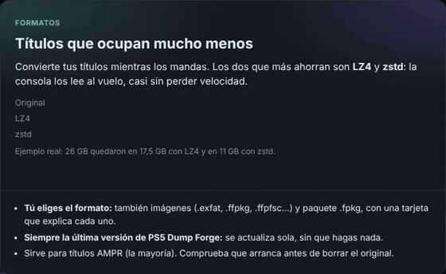 |
| **Pegas el enlace y listo.** Enlaces de descarga, torrents, carpetas del PC o de tu NAS. Descarga y envía a la vez, descomprime en la consola o en el PC, arregla los permisos y lo deja listo para ShadowMountPlus. | **Títulos que ocupan mucho menos.** Los convierte a LZ4 o zstd por el camino (26 GB → 11 GB en nuestra prueba). La consola los lee al vuelo. También imágenes (`.exfat`, `.ffpkg`, `.ffpfsc`…) y `.fpkg`. |
| 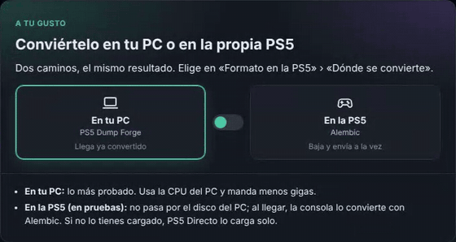 | 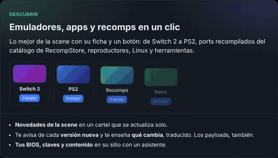 |
| **Convertido donde tú quieras.** En tu PC con la última versión de [PS5 Dump Forge](https://github.com/quer3q/ps5-dump-forge) (llega ya convertido) o en la propia PS5 con [Alembic](https://github.com/fthdgn-gh/Alembic) (descarga y envía a la vez, y la consola lo convierte al terminar). | **Emuladores, apps y recomps en un clic.** Switch 2, PS2, GameCube, Xbox 360, retro, reproductores, Linux y todo el catálogo de RecompStore. Te avisa de cada versión nueva, con sus notas traducidas. |
| 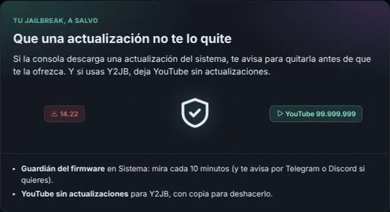 | 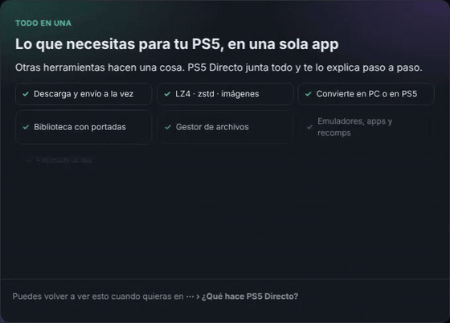 |
| **Tu jailbreak, a salvo.** Si la consola descarga una actualización del sistema, te avisa para quitarla antes de que se instale. Y si usas Y2JB, puede impedir que YouTube se actualice. | **Todo lo demás, en una sola app.** Biblioteca con portadas, gestor de archivos, limpieza de espacio, payloads al día, copias y capturas, Remote Play, Linux en la PS5 y control desde el móvil o el navegador. |

## Descarga e instalación

| Sistema | Archivo | Cómo |
|---|---|---|
| **Windows 10/11** | `PS5Directo-X.Y.Z-Setup.exe` | Ábrelo y pulsa **Instalar**. Sin permisos de administrador ni nada más que instalar. |
| **Mac** (beta) | `PS5Directo-X.Y.Z-macOS.dmg` | Arrastra **PS5 Directo** a Aplicaciones. Mira la nota de abajo. |
| **Linux** (x86-64) | `PS5Directo-X.Y.Z-Linux.tar.gz` | Descomprímelo y abre `./ps5directo.sh` una vez; se añade solo al menú de aplicaciones. |
| **Android** | `PS5Directo-X.Y.Z-Android.apk` | Dos formas: con tu PC (escanea el QR de **Móvil**) o **sin PC** (en pruebas): el móvil lo hace todo solo. |

Todos están en la [última release](../../releases/latest). PS5 Directo se actualiza solo desde la propia app.

- **Windows:** si dice «Windows protegió su PC», pulsa **Más información → Ejecutar de todos modos** (el instalador no está firmado, que cuesta dinero). ¿Prefieres no instalar? Usa `PS5Directo-X.Y.Z-Windows.zip` y ejecuta `Crear accesos directos.bat`.
- **Mac:** la app no está firmada por Apple. La primera vez ve a *Ajustes del Sistema → Privacidad y seguridad → Abrir igualmente* (en macOS antiguos: clic derecho en la app → *Abrir*). Si macOS dice que **«está dañada»**, ejecuta esto una vez en Terminal: `xattr -dr com.apple.quarantine "/Applications/PS5 Directo.app"`.
- **Linux:** los torrents necesitan `aria2` (`sudo apt install aria2`). Para la ventana de la app, Chrome, Chromium, Edge o Brave; si no, se abre en tu navegador.

## Qué necesitas en la PS5

Una PS5 con jailbreak en la misma red que tu PC, con:

- un servidor FTP, por ejemplo [ftpsrv](https://github.com/ps5-payload-dev/ftpsrv) (puerto 2121);
- [BFpilot](https://github.com/ItsBlurf/BFpilot) (puerto 5905), para descomprimir en la consola;
- [ShadowMountPlus](https://github.com/drakmor/ShadowMountPlus), para que lo que envíes salga en el menú.

PS5 Directo los comprueba, te dice si falta alguno y puede cargarlos por ti con [Payload Manager](https://github.com/itsPLK/ps5-payload-manager).

## Primeros pasos

1. Abre PS5 Directo. El idioma sigue al de tu sistema; se cambia con **English / Español** arriba.
2. Sigue la ventana de bienvenida: pon la IP de tu PS5 y comprueba la conexión y tu firmware.
3. Pega un enlace o arrastra un archivo, elige el formato si quieres y pulsa **Añadir a la cola**.

La primera vez verás un recorrido corto por todo lo que hace. Se puede volver a ver en **⋯ › ¿Qué hace PS5 Directo?**. La guía completa está en [LEEME.txt](LEEME.txt).

## Aviso

Proyecto independiente, sin relación con Sony ni con los autores de las herramientas que usa. Es un gestor de archivos: no incluye contenido de terceros, ni claves o archivos de Sony, ni enlaces a sitios de descargas. Úsalo solo con contenido que tengas derecho a usar (tus copias de seguridad y homebrew).

- No hace el jailbreak ni salta ninguna protección: solo trabaja con una consola que ya has modificado tú.
- No se da ayuda para conseguir contenido sin licencia.
- Lo que hagas con él es responsabilidad tuya. Modificar una consola puede anular su garantía, incumplir sus condiciones o hacerte perder datos: haz copia de lo importante.
- Se ofrece tal cual, sin garantías de ningún tipo. «PlayStation» y «PS5» son marcas de Sony Interactive Entertainment y se usan solo para indicar compatibilidad.
